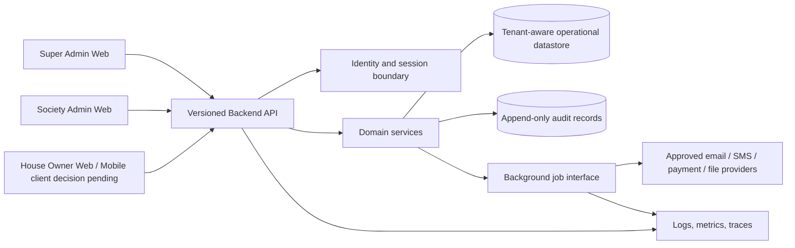

# Proposed Logical Architecture

**Status:** Vendor-neutral proposal for review; no technology selection is implied.  
Related: [SRS](./SRS.md), [Database ERD](./DATABASE_ERD.md), [Module Workflows](./MODULE_WORKFLOWS.md).

## 1. Context and boundaries



Clients are untrusted presentation layers. The backend is the policy and business-rule enforcement point. External services are behind explicit adapters; no integration is assumed just because an interface is shown.

**Current implementation note:** The Web application now provides a Super Admin
console backed by `/api/v1/platform` APIs for registration review, tenant lifecycle,
subscription plans, support-ticket tracking, audit search/export, and operational
summaries. The API role-checks every platform endpoint independently of the Web
navigation. Society Admin support tickets resolve tenant context from the active
server session and live membership. Accounting, maintenance billing, and payment
processing are not part of this implementation.

The Society Admin configuration module is exposed through tenant-scoped
`/api/v1/societies/{societyId}/settings` GET/PATCH routes. A validated active
membership and server-selected society context are required; write permission is
limited to Society Admins. Identity/locale/operational settings, approval policies,
and notification templates are tenant-keyed documents. Charge rules are immutable
per-society revisions with non-decreasing effective dates. Issued-bill snapshots
and a billing engine are not present in this phase.

## 2. Logical components

### 2.1 Web and mobile clients

- Role-aware navigation, accessible forms, validation feedback, and explicit active-tenant context.
- Consume the same versioned API and server-defined capabilities; they cannot authorize or calculate canonical financial state.
- Avoid persistent sensitive data. If offline/cache behavior is approved, define data minimization, encryption, expiry, logout purge, and conflict semantics first.
- Responsive web is a reasonable delivery option, not an approved decision on native/PWA/mobile scope.

### 2.2 API and application layer

Logical responsibilities (whether deployed together or separately is open):

1. Authentication/session validation.
2. Tenant-context resolution and membership lookup.
3. Authorization policy and field filtering.
4. Input/domain validation and state transitions.
5. Tenant-scoped persistence and transaction management.
6. Audit emission for sensitive events.
7. Rate limiting, pagination, idempotency, and request correlation.
8. Stable API errors and schema/version management.

### 2.3 Domain areas

- Platform/tenant lifecycle and admin assignment.
- Identity, role grants, membership verification, and homes.
- Communications and service requests.
- Financial charges, receipts, expenses, adjustments, and reports.
- Audit, notification, export, and operational interfaces.

These are logical ownership boundaries, not a commitment to microservices. Start with the simplest deployment structure that preserves explicit boundaries; deployment topology and modular monolith versus services remain D-15.

### 2.4 Persistence and isolation

- Every tenant-owned object is tenant-associated or has a provable tenant-scoped parent.
- All query paths, including background jobs and reporting, require explicit tenant context.
- Enforce tenant scope in application data-access patterns and, if selected datastore supports it, an additional database-level control.
- Consider composite tenant/resource keys and tenant-aware foreign keys to prevent cross-tenant relationships.
- Avoid global caches keyed only by object ID; include tenant and authorization-relevant variation.
- Use transactions for financial posting plus audit/outbox intent; make side effects retry-safe.
- Data store, schema migrations, encryption mechanisms, and isolation implementation are unresolved.

## 3. Trust boundaries and security flows

1. Client sends a credential/session and tenant context over TLS.
2. Backend validates identity and active session.
3. Backend resolves the principal's tenant-scoped role/membership from trusted records.
4. Backend authorizes action and record relationship before querying/returning protected data.
5. Domain operation validates state and invariants; transaction persists mutation and audit/outbox intent.
6. Asynchronous worker processes approved side effects idempotently and retains tenant scope.

Every step must reject missing or ambiguous identity/tenant/relationship context. Provider callback authentication and replay defense are mandatory if payment integrations are approved.

## 4. API and integration architecture

Follow API conventions in [SRS §8](./SRS.md#8-api-conventions). Proposed routes are tenant-scoped (illustrative only; final route shape is open):

```text
/api/v1/tenants/{tenantId}/profile
/api/v1/tenants/{tenantId}/homes
/api/v1/tenants/{tenantId}/members
/api/v1/tenants/{tenantId}/announcements
/api/v1/tenants/{tenantId}/requests
/api/v1/tenants/{tenantId}/financial-records
```

The server must confirm each `{tenantId}` is in the caller's authorized scope. Do not put secrets or sensitive identity data in URLs. Use request IDs and idempotency keys for retry-prone commands. Integrations use least-privilege credentials and validated, signed callbacks as appropriate.

## 5. Financial consistency and audit

- Canonical balances are calculated from committed financial events and allocations.
- Decimal precision, currency and posting status are explicit; no floating-point arithmetic.
- A posted entry is immutable; correction is a new linked event.
- Posting and audit/outbox intent are atomic or durably coupled. Notification/provider delivery happens after commit and cannot falsify the business transaction.
- Reconciliation/reporting uses a consistent snapshot or documented cutoff semantics.

## 6. Availability, observability, and recovery

- Instrument request latency/error rate, authorization denials, job retries, integration health, financial posting failures, and backup/restore health.
- Correlate requests and asynchronous work without logging tokens, credentials, or unnecessary personal/financial details.
- Alert on service objectives and critical operations; exact SLO, alert thresholds, on-call ownership, and operating hours remain open.
- Backups are encrypted, isolated, monitored, and restore-tested. RPO/RTO and retention require decision D-16.
- Deployments require reviewed migrations, health checks, rollback/forward-fix plan, and audit-safe handling of retries.

## 7. Architectural decisions still open

| Decision | Options/examples (not selected) | Required before |
|---|---|---|
| Hosting, regions, residency | Managed cloud/provider/region options | Production tenant data |
| Deployment style | Modular monolith or independently deployed services | Implementation planning |
| Database and tenant isolation | Relational/other; shared schema, schema, or database per tenant | Data implementation |
| Identity provider and auth protocol | Managed identity/OIDC or first-party auth | IAM implementation |
| Client delivery | Responsive web, PWA, native iOS/Android, combination | Client roadmap |
| File storage and scanning | Managed object storage and scanning provider | Attachments/documents |
| Email/SMS/push | Provider, consent, locale, retry policy | Notifications |
| Payment integration | Provider, callbacks, reconciliation/settlement | Online collections |
| Queue/cache/search/analytics | Only if product and scale justify | Relevant feature |
| RPO/RTO, SLO, support model | Business-approved values and ownership | Production release |

## 8. Architecture acceptance checks

- A two-tenant test proves no cross-tenant access through direct IDs, list/search, reports, exports, cache, jobs, or provider callbacks.
- Client tampering with tenant, owner, home, amount, status, or role cannot bypass server validation.
- Duplicate retry/callback does not duplicate financial posting or notifications.
- Audit failure behavior for sensitive mutations is safe and observable.
- Recovery exercise restores a verified dataset within approved RPO/RTO.
