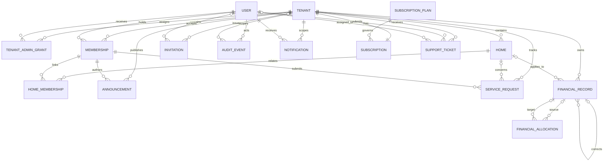

# Conceptual Database ERD

**Status:** Logical model draft, not a physical schema. Cardinalities and jurisdiction-specific fields require review.  
Related: [SRS](./SRS.md), [Architecture](./ARCHITECTURE.md), [Roadmap](./IMPLEMENTATION_ROADMAP.md).

## 1. Entity relationship diagram

The diagram expresses conceptual associations only. For example, `o|` is intentional where a platform-level action may not belong to one tenant. Physical referential constraints must reject cross-tenant relationships.

## 2. Entity intent and key invariants

| Entity | Purpose | Important invariants |
|---|---|---|
| `Tenant` | Society/community boundary and lifecycle | Stable opaque ID; status; display name is not key; suspension does not delete |
| `User` | Global authenticated principal | Stable principal ID independent of mutable email/phone; credentials are not exposed |
| `TenantAdminGrant` | Platform-issued tenant-admin assignment | Tenant, user, grantor, scope/status, effective dates; auditable and revocable |
| `Membership` | User's tenant role/status and verification | Tenant + user relationship; role and lifecycle; uniqueness/multi-role rule unresolved |
| `Home` | Tenant-owned dwelling/unit | Tenant-scoped unique label policy; status; never identify by address alone |
| `HomeMembership` | Time-bounded relationship between membership and home | Relationship type, verification, effective interval; preserve history |
| `Invitation` | Time-limited onboarding capability | Tenant, intended role/recipient, token digest only, expiry, single-use/revocation |
| `Announcement` | Tenant notice with audience and publication lifecycle | Tenant, author, state, audience, published time; revision policy unresolved |
| `ServiceRequest` | Owner-submitted operational issue | Tenant, submitter, optional home, status, assignment/history; internal-note access controlled |
| `FinancialRecord` | Charge, receipt, expense, refund, reversal, adjustment | Tenant, type, amount, currency, status, dates, source/correction link; immutable after posting |
| `FinancialAllocation` | Links payment/credit to charge or other approved target | Same tenant and compatible currency; amount within permitted bounds |
| `AuditEvent` | Append-only accountability record | Actor, tenant context, action, target, timestamp, outcome, minimal payload |
| `Notification` | Delivery/read state distinct from business data | Recipient, tenant, event reference, channel/status; no authority to alter source state |
| `SubscriptionPlan` | Platform-defined plan, limits and optional price metadata | Unique plan code; archived plans cannot be newly assigned; payment processing is separate |
| `Subscription` | Tenant's current plan, status, explicit trial period and limit snapshot | One current subscription per tenant; configured by platform actor; no billing ledger |
| `SupportTicket` | Tenant-scoped support request tracked by the platform | Creator and tenant are server-bound; platform ticket access does not imply access to tenant business data |

## 3. Common data requirements

- Use opaque stable primary IDs; do not rely on sequential IDs for authorization.
- Tenant-owned entities include a `tenant_id` or enforce tenant through a composite/parent relationship. If redundant tenant ID is stored, validate it against the parent.
- Store created/updated timestamps consistently; use UTC instants with clear serialization. Effective dates for ownership/membership are separate domain dates/instants.
- Store actor/source attribution for sensitive mutations. Soft deletion/archive is not a substitute for a defined retention policy.
- Monetary amounts use exact decimal representation or integer minor units with currency-specific scale. Currency is required and not inherited silently.
- Separate drafts from posted records; preserve immutable posted history and link corrections.
- Do not store raw invitation tokens, passwords, payment credentials, or secrets. Store digests/references where applicable.
- Avoid unnecessary personally identifiable information. Define retention and access by field category.
- Indexes and uniqueness must include tenant scope where appropriate; query plans and constraints must prevent cross-tenant links.

## 4. Relationship questions requiring decisions

1. Can one person have multiple roles within a tenant or memberships in many tenants? (SRS D-06)
2. Is an owner-to-home relationship one-to-one, many-to-one, or many-to-many; are renters/occupants represented? (D-07)
3. Are financial records attached to a home, a member account, or both? How are balances transferred on ownership change? (D-02/D-03/D-07)
4. Are expenses records in a lightweight sub-ledger or full chart-of-accounts model? (D-02)
5. Do announcements need immutable revision history, read receipts, and audience snapshots?
6. Can a service request exist without a home, and how are internal notes modeled?
7. What retention/deletion/anonymization rules apply to user and tenant records while preserving legal records? (D-01/D-14)
8. Which attachment/document metadata and storage policy is required? (D-10)

## 5. Data integrity acceptance checks

- Constraints or domain validation reject a home/member/financial allocation relationship spanning two tenants.
- Ownership history supports a transfer without rewriting prior relationship or financial attribution.
- Reversals link to an existing same-tenant original and preserve both entries.
- Duplicate idempotency key cannot create duplicate posted records.
- Tenant-scoped unique labels allow identical labels in different tenants while enforcing the approved within-tenant rule.
- User deletion/deactivation does not erase the identity needed to interpret historical audit and financial attribution.
